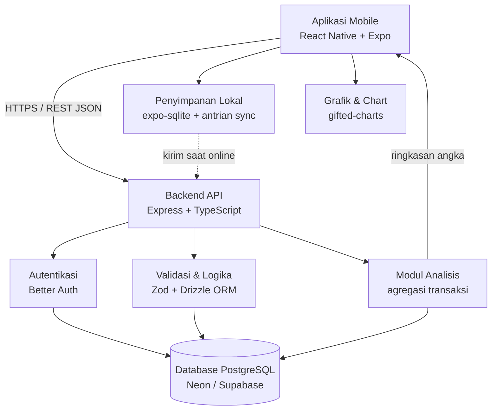
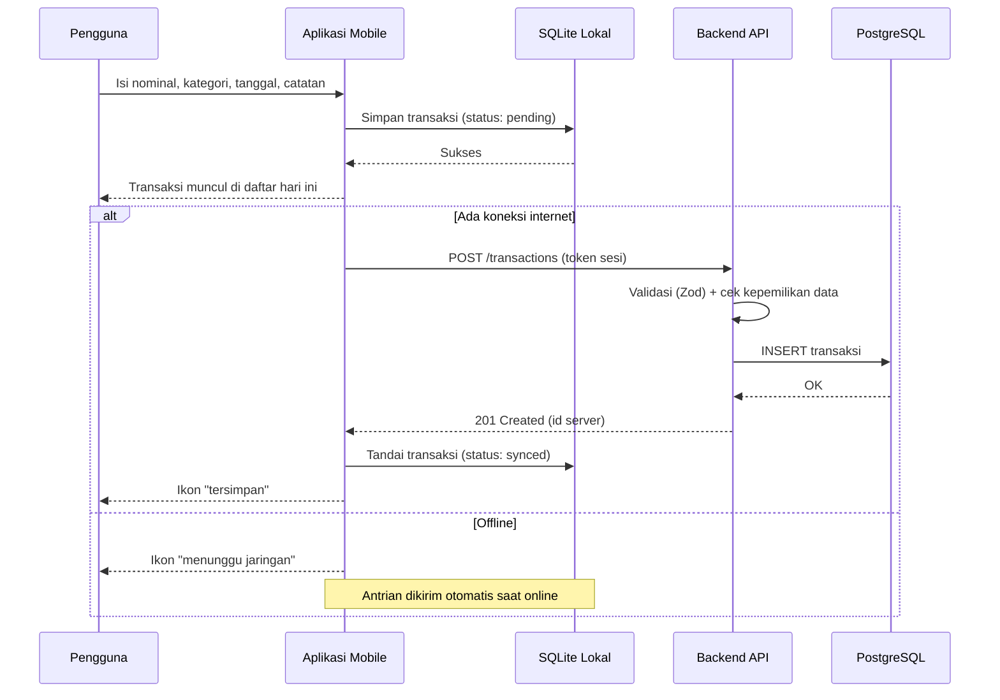
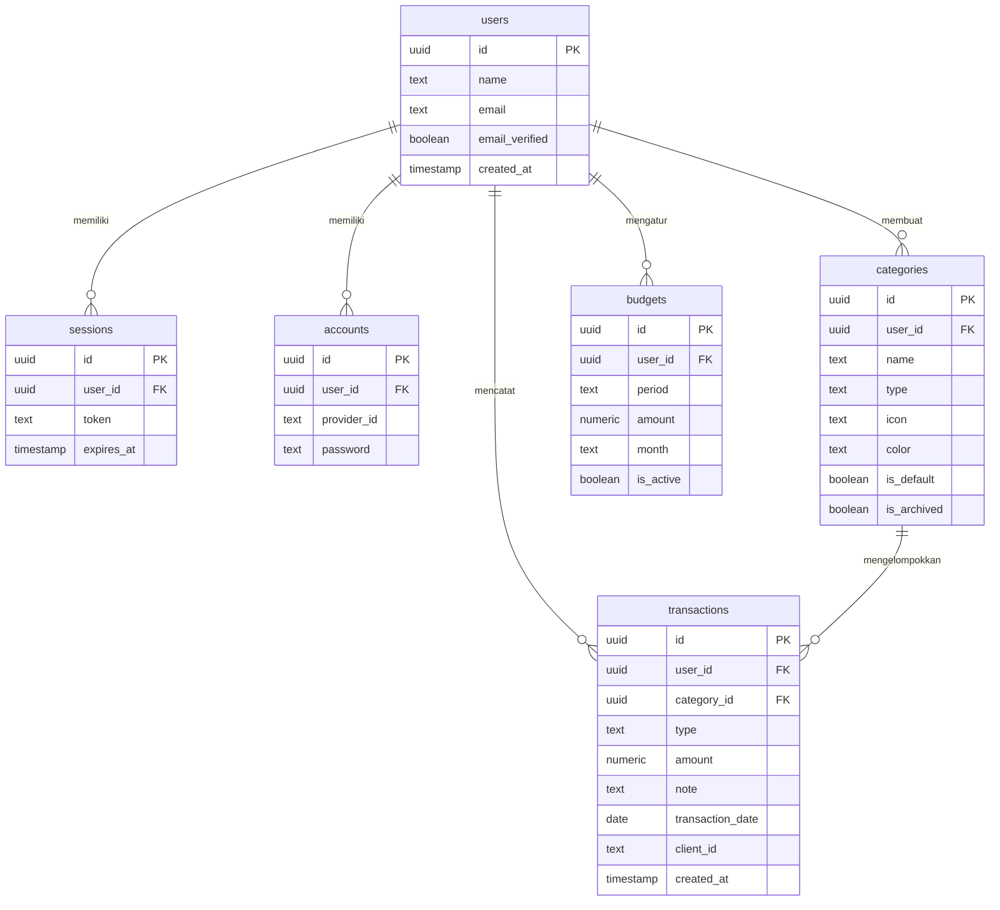

# PRD — Project Requirements Document

## 1. Overview

### Masalah yang Diselesaikan
Banyak orang masih mencatat keuangan pakai Excel atau buku catatan. Cara ini terasa ribet: harus buka laptop, isi kolom manual, dan susah dipakai saat sedang di luar rumah. Akibatnya catatan sering bolong, dan pengguna baru sadar uangnya habis setelah terjadi — alias boncos.

### Tujuan Utama Aplikasi
Membuat aplikasi mobile pencatat keuangan pribadi yang **cepat dipakai dalam hitungan detik**, sehingga pengguna bisa:

1. Mencatat pengeluaran dan pemasukan langsung dari ponsel, kapan pun dan di mana pun.
2. Tahu ke mana saja uangnya pergi lewat kategori transaksi.
3. Melihat analisis sederhana (grafik & rekap bulanan) supaya bisa mengontrol pengeluaran sebelum kehabisan uang.
4. Menyimpan data dengan aman di server, sehingga tidak hilang walau ganti ponsel.

### Target Pengguna
Orang yang sebelumnya mencatat keuangan pakai Excel/spreadsheet dan ingin cara yang lebih gampang. Bukan akuntan, bukan pebisnis — fokusnya kebutuhan rumah tangga dan pribadi.

### Nilai Jual Utama
**Lebih gampang daripada Excel.** Tiga ketukan untuk satu transaksi, tanpa kolom dan tanpa rumus.

---

## 2. Requirements

### Kebutuhan Fungsional (yang harus bisa dilakukan aplikasi)
| No | Kebutuhan | Keterangan |
|----|-----------|------------|
| F1 | Catat pengeluaran & pemasukan | Nominal, kategori, catatan singkat, tanggal transaksi |
| F2 | Kelola kategori | Kategori bawaan + kategori buatan sendiri, lengkap dengan ikon & warna |
| F3 | Riwayat transaksi | Daftar lengkap, bisa dicari, difilter, diedit, dan dihapus |
| F4 | Grafik & analisis | Grafik per kategori, tren harian, perbandingan masuk vs keluar |
| F5 | Rekap bulanan | Total masuk, total keluar, sisa uang, dan peringatan boncos |
| F6 | Akun pengguna | Daftar, login, logout, reset password |
| F7 | Sinkronisasi ke server | Simpan otomatis, muat ulang data, indikator status koneksi |
| F8 | Pengaturan | Profil, batas pengeluaran, ekspor data |

### Kebutuhan Non-Fungsional
- **Cepat:** satu transaksi selesai < 10 detik; aplikasi terbuka < 3 detik.
- **Bisa dipakai tanpa internet:** transaksi tetap bisa dicatat dan disimpan lokal, lalu dikirim ke server saat koneksi kembali.
- **Aman:** data hanya bisa diakses pemilik akun; kata sandi disimpan terenkripsi; komunikasi lewat HTTPS.
- **Rapi secara tampilan:** angka uang memakai format Rupiah (Rp1.234.567), antarmuka bahasa Indonesia.
- **Mobile-first:** dirancang untuk layar ponsel Android & iOS, tombol besar dan mudah dijangkau jempol.
- **Data tidak hilang:** sinkronisasi bersifat idempotent (transaksi yang sama tidak tercatat dua kali).

### Ruang Lingkup MVP
Fase 1–3 adalah inti yang harus selesai lebih dulu (aplikasi sudah berguna meski tanpa akun). Fase 4–5 melengkapi keamanan, sinkronisasi, dan kustomisasi.

### Batasan & Asumsi
- Satu pengguna hanya mengelola keuangannya sendiri (bukan multi-user/keluarga) di versi awal.
- Mata uang tunggal: IDR.
- Tidak ada integrasi rekening bank otomatis.

---

## 3. Core Features

### Fase 1 — Catat Transaksi `[high]`
Layar utama untuk mencatat pengeluaran dan pemasukan dalam hitungan detik.
- **Input Pengeluaran** — Masukkan nominal uang yang dibelanjakan hari ini, lengkap dengan pilihan cepat (mis. nominal umum).
- **Input Pemasukan** — Catat uang masuk seperti gaji, bonus, atau pemasukan lain.
- **Pilih Kategori** — Tandai transaksi masuk ke kategori apa supaya rapi.
- **Catatan & Tanggal** — Tambahkan keterangan singkat dan atur tanggal transaksi (default hari ini).

### Fase 2 — Riwayat Transaksi `[high]`
Lihat semua catatan uang yang pernah dimasukkan dalam satu daftar.
- **Daftar Transaksi** — Telusuri transaksi terbaru sampai terlama, dikelompokkan per tanggal.
- **Cari & Filter** — Temukan transaksi berdasarkan kata kunci, kategori, jenis (masuk/keluar), atau rentang tanggal.
- **Edit & Hapus** — Perbaiki atau hapus catatan yang salah masuk, dengan konfirmasi sebelum menghapus.

### Fase 2 — Kategori Transaksi `[medium]`
Kelompokkan setiap transaksi agar mudah dipahami dan dianalisis.
- **Kategori Bawaan** — Kategori siap pakai seperti makan, transport, belanja, tagihan, gaji.
- **Tambah Kategori Sendiri** — Buat kategori baru sesuai kebiasaan belanja.
- **Ikon & Warna Kategori** — Tanda visual supaya kategori mudah dikenali sekilas.

### Fase 3 — Grafik Pengeluaran `[high]`
Lihat pola pengeluaran dalam bentuk grafik yang gampang dibaca.
- **Grafik per Kategori** — Ketahui kategori mana yang paling menghabiskan uang.
- **Tren Harian** — Pantau naik turun pengeluaran dari hari ke hari.
- **Pemasukan vs Pengeluaran** — Bandingkan uang masuk dan keluar dalam satu tampilan.

### Fase 3 — Rekap Bulanan `[high]`
Ringkasan kondisi keuangan tiap bulan supaya tidak boncos.
- **Ringkasan Total Bulan** — Total pemasukan, pengeluaran, dan sisa uang bulan ini.
- **Pilih Bulan** — Geser ke bulan lain untuk melihat rekap sebelumnya.
- **Peringatan Boncos** — Tanda peringatan saat pengeluaran mendekati (mis. 80%) atau melewati pemasukan.

### Fase 4 — Autentikasi `[medium]`
Amankan catatan keuangan dengan akun pribadi.
- **Daftar Akun** — Buat akun (email + kata sandi) supaya data tersimpan atas nama sendiri.
- **Login & Logout** — Masuk dan keluar aplikasi dengan aman.
- **Reset Password** — Pulihkan akses akun saat lupa kata sandi lewat tautan/OTP email.

### Fase 4 — Sinkronisasi Data `[medium]`
Catatan tersimpan di server sehingga tidak hilang walau ganti ponsel.
- **Simpan Otomatis** — Setiap transaksi langsung dikirim dan disimpan ke server.
- **Ambil Data dari Server** — Muat ulang semua catatan saat membuka aplikasi di perangkat lain.
- **Status Koneksi** — Tahu kapan catatan sudah tersimpan dan kapan masih menunggu jaringan (antrian tersimpan lokal).

### Fase 5 — Pengaturan `[low]`
Atur aplikasi agar sesuai kebiasaan mencatat.
- **Profil Pengguna** — Lihat dan ubah nama serta email akun.
- **Atur Batas Pengeluaran** — Tentukan batas belanja harian atau bulanan sebagai pengingat.
- **Ekspor Data** — Unduh catatan keuangan (CSV) untuk disimpan atau dibuka di tempat lain.

---

## 4. User Flow

### A. Pertama Kali Buka Aplikasi (First Win: Catat Pengeluaran)
1. Pengguna membuka aplikasi → layar utama langsung menampilkan tombol besar "Catat Pengeluaran".
2. Pengguna memasukkan nominal → memilih kategori (kategori bawaan sudah tersedia).
3. Pengguna menekan "Simpan" → transaksi muncul di daftar hari ini, total pengeluaran hari ini ikut terupdate.
4. Muncul ajakan lembut untuk membuat akun agar data tersimpan di server (bisa dilewati dulu — "nanti saja").

### B. Mencatat Pemasukan
1. Dari layar utama, pengguna beralih ke tab "Pemasukan".
2. Isi nominal, kategori (gaji/bonus/lainnya), tanggal, catatan → Simpan.
3. Saldo bulan berjalan ikut bertambah.

### C. Menelusuri & Memperbaiki Riwayat
1. Buka tab "Riwayat" → daftar transaksi terbaru muncul.
2. Ketik kata kunci atau pilih filter kategori/tanggal → daftar menyempit.
3. Ketuk satu transaksi → layar detail → "Edit" atau "Hapus" (dengan konfirmasi).
4. Setelah disimpan, daftar dan total langsung diperbarui.

### D. Melihat Analisis & Rekap
1. Buka tab "Analisis" → grafik per kategori dan tren harian bulan ini tampil.
2. Geser pemilih bulan → grafik dan rekap bulan lain dimuat.
3. Bila pengeluaran ≥ 80% pemasukan, muncul kartu peringatan boncos berwarna oranye; bila melewati 100%, berwarna merah.

### E. Daftar, Login, dan Ganti Ponsel
1. Pengguna membuat akun (email + kata sandi) → data lokal yang sudah ada otomatis diunggah ke server.
2. Di ponsel baru, pengguna login → aplikasi mengunduh semua transaksi, kategori, dan pengaturan.
3. Setiap transaksi baru langsung disimpan ke server; bila offline, transaksi masuk antrian dan ditandai "menunggu terkirim" sampai koneksi kembali.

### F. Mengatur Batas & Ekspor
1. Buka tab "Pengaturan" → "Atur Batas Pengeluaran" → pilih harian/bulanan → isi nominal.
2. Saat mendekati batas, aplikasi menampilkan pengingat di layar utama.
3. Pengguna memilih "Ekspor Data" → memilih rentang tanggal → file CSV diunduh/dibagikan.

---

## 5. Architecture

### Gambaran Sistem
Aplikasi memakai pola **client–server** sederhana:

- **Aplikasi Mobile (React Native + Expo)** — menampilkan antarmuka, menyimpan salinan data di perangkat (SQLite lokal + antrian sinkronisasi), dan mengirim transaksi ke API.
- **Backend API (Express + TypeScript)** — memvalidasi data, menangani autentikasi (Better Auth), serta menghitung ringkasan/analisis.
- **Database PostgreSQL** — menyimpan data permanen pengguna, kategori, transaksi, dan batas pengeluaran.
- **Lapisan Analisis** — grafik dan rekap dihitung dari data transaksi (query agregasi di backend), lalu dikirim sebagai angka ringkas ke aplikasi; grafik digambar di sisi mobile.

### Alur Utama: Simpan Transaksi dengan Sinkronisasi

### Catatan Arsitektur
- Semua endpoint selain daftar/login wajib memakai token sesi; server hanya mengembalikan data milik pengguna yang login.
- Setiap transaksi punya `client_id` unik dari perangkat agar pengiriman ulang tidak membuat data ganda.
- Ringkasan bulanan tidak disimpan sebagai tabel terpisah di MVP — dihitung dari data transaksi agar selalu akurat.

---

## 6. Database Schema

Semua tabel memakai `id` berupa UUID. Tabel `users`, `sessions`, `accounts`, dan `verifications` mengikuti skema bawaan Better Auth.

### Tabel `users`
| Field | Tipe | Kegunaan |
|-------|------|----------|
| id | UUID (PK) | Identitas unik pengguna |
| name | TEXT | Nama tampilan pengguna |
| email | TEXT (unique) | Email untuk login |
| email_verified | BOOLEAN | Status verifikasi email |
| image | TEXT (nullable) | URL foto profil |
| created_at | TIMESTAMP | Waktu akun dibuat |
| updated_at | TIMESTAMP | Waktu akun terakhir diubah |

### Tabel `sessions`
| Field | Tipe | Kegunaan |
|-------|------|----------|
| id | UUID (PK) | Identitas sesi login |
| user_id | UUID (FK → users.id) | Pemilik sesi |
| token | TEXT | Token sesi yang dipakai aplikasi |
| expires_at | TIMESTAMP | Waktu kedaluwarsa sesi |
| created_at | TIMESTAMP | Waktu sesi dibuat |

### Tabel `accounts`
| Field | Tipe | Kegunaan |
|-------|------|----------|
| id | UUID (PK) | Identitas akun kredensial |
| user_id | UUID (FK → users.id) | Pemilik akun |
| provider_id | TEXT | Metode login (mis. `credential`) |
| password | TEXT | Kata sandi terenkripsi (hash) |
| created_at | TIMESTAMP | Waktu dibuat |

### Tabel `categories`
| Field | Tipe | Kegunaan |
|-------|------|----------|
| id | UUID (PK) | Identitas kategori |
| user_id | UUID (FK → users.id, nullable) | `NULL` = kategori bawaan sistem; terisi = milik pengguna |
| name | TEXT | Nama kategori (Makan, Transport, Gaji, …) |
| type | ENUM(`expense`,`income`,`both`) | Jenis transaksi yang cocok |
| icon | TEXT | Nama ikon yang ditampilkan |
| color | TEXT | Kode warna (hex) untuk grafik & label |
| is_default | BOOLEAN | Penanda kategori bawaan |
| is_archived | BOOLEAN | Sembunyikan tanpa menghapus data historis |
| created_at | TIMESTAMP | Waktu dibuat |

### Tabel `transactions`
| Field | Tipe | Kegunaan |
|-------|------|----------|
| id | UUID (PK) | Identitas transaksi di server |
| user_id | UUID (FK → users.id) | Pemilik transaksi |
| category_id | UUID (FK → categories.id) | Kategori transaksi |
| type | ENUM(`expense`,`income`) | Pengeluaran atau pemasukan |
| amount | NUMERIC(14,2) | Nominal uang (Rupiah, selalu positif) |
| note | TEXT (nullable) | Keterangan singkat |
| transaction_date | DATE | Tanggal transaksi (bisa diubah manual) |
| client_id | TEXT (unique per user) | Kunci idempotensi dari perangkat |
| created_at | TIMESTAMP | Waktu input |
| updated_at | TIMESTAMP | Waktu terakhir diubah |

### Tabel `budgets`
| Field | Tipe | Kegunaan |
|-------|------|----------|
| id | UUID (PK) | Identitas aturan batas |
| user_id | UUID (FK → users.id) | Pemilik batas |
| period | ENUM(`daily`,`monthly`) | Periode batas pengeluaran |
| amount | NUMERIC(14,2) | Nominal batas belanja |
| month | TEXT (nullable) | Bulan berlaku (`YYYY-MM`), kosong = berulang tiap bulan |
| is_active | BOOLEAN | Status aktif |
| created_at | TIMESTAMP | Waktu dibuat |

### Relasi Antar Tabel

### Catatan Basis Data
- Indeks penting: `transactions (user_id, transaction_date)`, `transactions (user_id, category_id)`, dan `UNIQUE (user_id, client_id)`.
- Ringkasan harian/bulanan dihitung lewat query agregasi (`SUM` per tipe dan kategori) sehingga tidak perlu tabel tambahan di MVP.
- `categories.user_id` bernilai `NULL` untuk kategori bawaan agar bisa dipakai semua pengguna tanpa duplikasi.

---

## 7. Tech Stack

Semua bagian dipilih dengan prioritas: **cepat dibangun, mudah dirawat, biaya awal rendah.**

### Frontend (Mobile)
| Komponen | Pilihan | Alasan |
|----------|---------|--------|
| Framework | **React Native + Expo (SDK terbaru)** | Sesuai permintaan, satu basis kode untuk Android & iOS |
| Bahasa | **TypeScript** | Mengurangi bug pada data keuangan |
| Navigasi | **Expo Router** (tab-based) | Struktur tab rapi: Catat, Riwayat, Analisis, Pengaturan |
| Styling/UI | **NativeWind (Tailwind untuk RN)** + komponen kustom sederhana | Konsisten, ringan, cepat disesuaikan |
| State & Data | **Zustand** + **TanStack Query** | Cache data server + refetch otomatis saat online |
| Form & Validasi | **react-hook-form + Zod** | Validasi sama dengan backend |
| Grafik | **react-native-gifted-charts** | Ringan, mudah dipakai untuk donut & line chart |
| Penyimpanan Lokal | **expo-sqlite** + `expo-network` | Cache offline & antrian sinkronisasi |
| Notifikasi/Unduh | **expo-notifications**, **expo-sharing / expo-file-system** | Pengingat batas & ekspor CSV |

### Backend
| Komponen | Pilihan | Alasan |
|----------|---------|--------|
| Runtime & Framework | **Node.js + Express + TypeScript** | Sesuai permintaan, ekosistem luas |
| Autentikasi | **Better Auth** (email + password, reset via email) | Ringan, terintegrasi baik dengan Express & Drizzle |
| ORM & Migrasi | **Drizzle ORM + drizzle-kit** | Query bertipe, migrasi jelas |
| Validasi | **Zod** | Satu skema dipakai ulang di frontend & backend |
| Dokumentasi API | **Swagger (swagger-ui-express)** | Memudahkan pengujian endpoint |
| Keamanan | **helmet, cors terbatas, rate limit** | Melindungi API publik |

### Database & Deployment
| Komponen | Pilihan | Alasan |
|----------|---------|--------|
| Database | **PostgreSQL** — Neon (free tier) atau Supabase | Andal untuk data transaksi, query agregasi kuat |
| Backend Hosting | **Railway** atau **Render** | Deploy mudah dari repo GitHub, biaya awal rendah |
| Mobile Build | **EAS Build + EAS Update** | Build APK/IPA & update OTA tanpa repot |
| Monitoring | **Sentry** (mobile & backend) | Melacak error di produksi |
| Email Transaksional | **Resend** (untuk reset password) | Setup cepat, kuota gratis memadai |

### Catatan Implementasi
- Format uang memakai `Intl.NumberFormat('id-ID', { style: 'currency', currency: 'IDR' })`.
- Sinkronisasi memakai pola **"local-first"**: transaksi disimpan lokal dulu, lalu dikirim ke server dengan `client_id` sebagai kunci anti-duplikat.
- Semua endpoint transaksi/kategori/rekap dilindungi middleware sesi Better Auth dan difilter berdasarkan `user_id`.